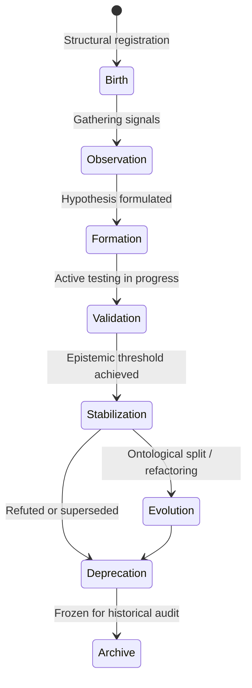

# COM-0000: Cognitive Object Model (COM)

## 1. Objective
To define the abstract, structural properties and lifecycle states of any entity (Cognitive Object) within the Cognitive Systems Engineering Reference Standard (CSERS).

---

## 2. Object Schema

A Cognitive Object is a logical container representing a node of meaning. Regardless of its physical serialization (Markdown, JSON, RDF, SQL, etc.), the Cognitive Object Model dictates that it must expose the following abstract fields:

* **Identity**: The permanent, immutable URI (`cse://`).
* **Type**: The type classification defined by the Cognitive Type System (CTS).
* **State**: The runtime status (e.g., active, dormant, archived).
* **Lifecycle**: The developmental stage of the object (e.g., Validation, Stabilization).
* **Lineage**: The provenance chain tracking predecessor objects and mutations.
* **Evidence**: Links to supporting observations, metrics, or experiment runs.
* **Confidence**: The dynamic epistemic value ($0.00$ to $1.00$).
* **Dependencies**: A list of parent URIs that must remain valid for this object to exist.
* **Constraints**: Schema rules and invariants that this object must satisfy.
* **Observers**: The frame of reference references that observed or generated the entity.
* **History**: An audit trail of modifications.

---

## 3. Lifecycle States

Every Cognitive Object progresses through a formal, irreversible state-transition model:

* **Birth**: The definition is registered in the LKB (no observations yet).
* **Observation**: The system scans the environment for signals matching the birth template.
* **Formation**: The concept is initialized with assumptions, dependencies, and predictions.
* **Validation**: The object is subjected to active testing (confidence score between $0.30$ and $0.60$).
* **Stabilization**: The object achieves verified theory status (confidence score $\ge 0.70$).
* **Evolution**: The object adapts, undergoes structural splits, or merges with other objects.
* **Deprecation**: The object is invalidated (confidence score drops below $0.30$, or it is superseded by a newer version).
* **Archive**: The object is frozen. It is excluded from active reasoning loops but retained for lineage tracing.
