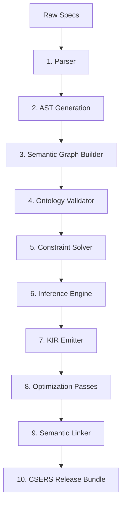

# COMPILER-0000: Knowledge Compiler Pipeline

## 1. Objective
To specify the compilation pipeline stages that compile raw, human-readable specifications into optimized, executable Knowledge Intermediate Representation (KIR) files.

---

## 2. The Ten Compilation Stages

The compiler translates, validates, and optimizes cognitive files through ten sequential passes:

### Stage 1: Parser
* **Process**: Tokenizes and parses raw text files (Markdown or DSL) to identify namespaces, metadata blocks, and statements.

### Stage 2: AST Generation
* **Process**: Structures tokens into an Abstract Syntax Tree (AST) representing concepts, rules, and mappings.

### Stage 3: Semantic Graph Builder
* **Process**: Resolves namespaces (`cse://`) and links nodes to generate a relational graph of primitives.

### Stage 4: Ontology Validator
* **Process**: Verifies that every node and relation complies with the Cognitive Type System (CTS).

### Stage 5: Constraint Solver
* **Process**: Executes constraint validation against schemas and system invariants (e.g., verifying that no meaning primitive lacks context).

### Stage 6: Inference Engine
* **Process**: Runs logical deduction to infer implicit graph relations (such as transitive dependencies) and updates the graph structure.

### Stage 7: KIR Emitter
* **Process**: Generates intermediate KIR files, translating all assignments into the Cognitive Single Assignment (CSA) format.

### Stage 8: Optimization Passes
* **Process**: Executes Dead Knowledge Elimination (DKE), Semantic Compression, and Contradiction Reduction passes over the KIR.

### Stage 9: Semantic Linker
* **Process**: Resolves external model mappings, merges schemas, and links dependencies between separate knowledge packages.

### Stage 10: Standard Emitter
* **Process**: Bundles the linked KIR into the final CSERS Release Bundle (LKB build) ready for runtime consumption.
