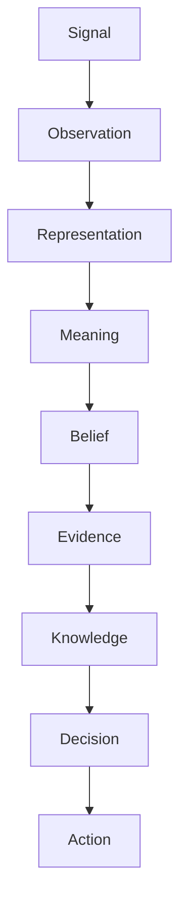

# CSEL-0001: Cognitive Type Theory (CTT)

## 1. Objective
To define the formal type lattice, transition rules, and compile-time type-safety checks of the Cognitive Systems Engineering Language (CSEL).

---

## 2. The Cognitive Type Lattice

Cognitive types exist in a hierarchical, directed lattice representing the progression of epistemic certainty and state collapse:

---

## 3. Epistemic Transition Constraints

To prevent cognitive leaps (such as executing decisions directly from raw sensory signals without ontological framing or verification), CSEL enforces strict type-transition limits.

### Valid Transitions:
An expression or equation is type-safe if and only if it follows the sequential path of the lattice:

* **Perception**:
  $$\text{Signal} + \text{Context} \to \text{Observation}$$
* **Structuring**:
  $$\text{Observation} + \text{Schema} \to \text{Representation}$$
* **Relational Mapping**:
  $$\text{Representation} + \text{Observer Frame} \to \text{Meaning}$$
* **Hypothesizing**:
  $$\text{Meaning} + \text{Context} \to \text{Belief}$$
* **Verification**:
  $$\text{Belief} + \text{Evidence} \to \text{Knowledge}$$
* **Gate Action**:
  $$\text{Knowledge} + \text{Constraints} \to \text{Decision}$$

---

## 4. Prohibited Transitions & Type Errors

The CSEL compiler checker halts and throws errors on direct shortcuts:

* **Signal $\to$ Decision**: Rejects actions executed without reasoning or verification.
  *Error Code*: `CSE-TYPE-001: Illegal epistemic transition. Decision requires validated Knowledge state.`
* **Belief $\to$ Knowledge (without Evidence)**: Rejects dogmatic statements of truth without empirical validation.
  *Error Code*: `CSE-TYPE-002: Invalidation of proof. Cannot collapse Belief to Knowledge without linked Evidence.`
* **Signal $\to$ Meaning (without Observer)**: Rejects observer-free meaning generation, enforcing observer dependency.
  *Error Code*: `CSE-TYPE-003: Observer Frame missing. Meaning cannot exist in isolation.`
