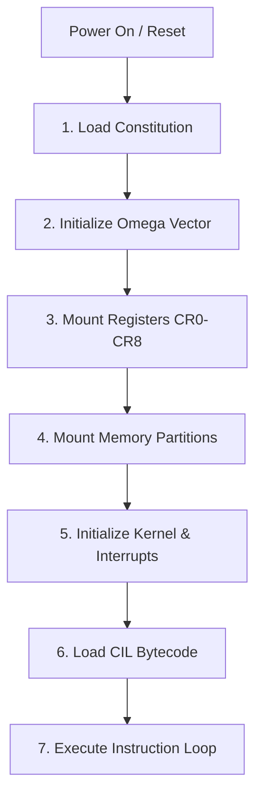

# CVM-BOOT-0000: Cognitive Boot Sequence

## 1. Objective
To specify the startup and initialization sequence of the Cognitive Virtual Machine (CVM), detailing how a blank virtual processor state mounts its invariants and transitions into active execution.

---

## 2. The Startup Sequence

The CVM boot sequence is executed in seven sequential steps:

### Step 1: Load Constitution
* **Process**: Parse and compile [CONSTITUTION.md](file:///c:/Users/WDAGUtilityAccount/Downloads/projeto/CONSTITUTION.md) invariants.
* **Goal**: Lock constitutional constants (`cse://invariant/`) in a read-only memory segment.

### Step 2: Initialize Omega Vector
* **Process**: Initialize the genesis state vector:
  $$\Omega_0 = (I_0, C_0, M_0, K_0, B_0, U_0, T_0, E_0, G_0)$$
* **Goal**: Set the baseline energy budget ($E_0$) and establish the initial ignorance interval ($\Delta = 1.0$).

### Step 3: Mount Registers CR0-CR8
* **Process**: Instantiate the cognitive register space. Set initial values:
  * `CR5` (Resource Budget) $\to$ system baseline.
  * `CR6` (Lineage) $\to$ `cse://invariant/genesis`.
  * `CR8` (Purpose Vector) $\to$ baseline system goals.

### Step 4: Mount Memory Partitions
* **Process**: Mount virtual graph sectors for Working, Semantic, Episodic, and Genetic Memory.

### Step 5: Start Kernel & Interrupts
* **Process**: Initialize the Scheduler, Resource Manager, and the Interrupt Vector Table.

### Step 6: Load CIL Program
* **Process**: Ingest the compiled CIL bytecode package into Working Memory.

### Step 7: Start Instruction Loop
* **Process**: Initialize the first thread execution context and trigger the CVM clock.
