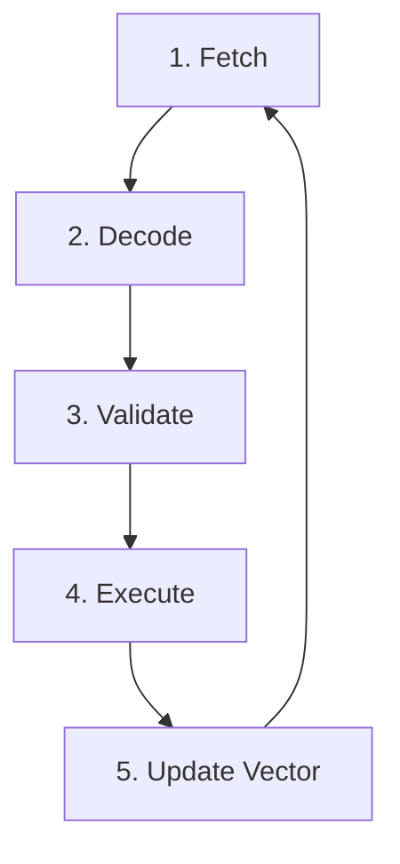

# CVM-0006: Execution Semantics & Cycle

## 1. Objective
To specify the instruction execution semantics of the CVM, detailing the cycle of the virtual CPU and scheduling priority rules.

---

## 2. The Cognitive Execution Cycle

The CVM processes instructions sequentially within an execution thread through a five-stage loop:

### Stage 1: Fetch
* **Process**: Read the next CIL instruction opcode pointed to by the virtual instruction pointer (`CIP`).

### Stage 2: Decode
* **Process**: Identify the instruction operands, source registers, and destination registers.

### Stage 3: Validate (Epistemic Shield)
* **Process**: Verify that the instruction parameters do not violate the Cognitive Type Theory (CTT) rules, dependencies are satisfied, and registers contain valid URIs.
* **Failures**: If a check fails, the CVM immediately raises corresponding type or constraint interrupts.

### Stage 4: Execute
* **Process**: Dispatch the operational command (e.g., `INFER`, `COLLAPSE_STATE`) to the respective CVM execution unit.

### Stage 5: Update Vector
* **Process**: Recalculate resource costs and update the active Omega state vector ($\Omega_{t} \to \Omega_{t+1}$). Increment `CIP`.

---

## 3. Cognitive Scheduling Rules

The CVM Scheduler allocates compute resources and attention (`CR7`) dynamically to competing processes using a scheduling weight calculation:

* **Scheduling Weight ($W_{\text{sched}}$)**:
  $$W_{\text{sched}} = \text{Priority(CR8)} \cdot \text{Uncertainty(CR4)} \cdot e^{-\text{EnergyCost}}$$

### Scheduling Rules:
1. **Attention Allocation**: Threads with higher $W_{\text{sched}}$ receive a higher share of the Attention State (`CR7`) budget.
2. **Resource Depletion**: If `CR5` (Resource Budget) drops below a threshold, the scheduler halts low-priority tasks and triggers a clean-up interrupt.
