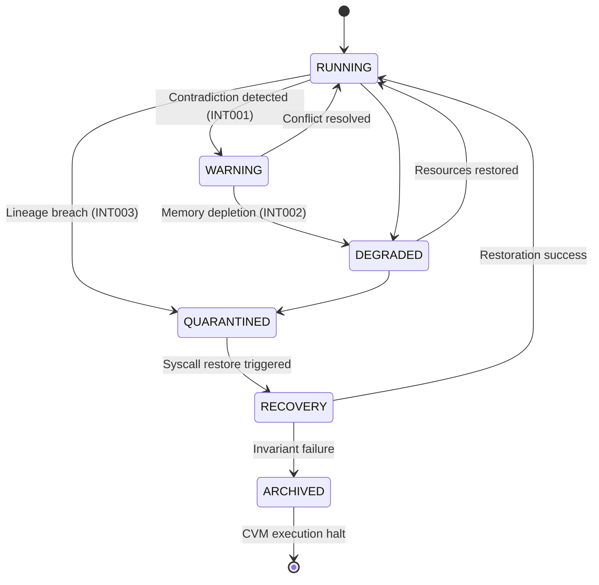

# CVM-HW-0004: Fault Handling & States

## 1. Objective
To define the operational and fault states of the CVM, establishing how the virtual CPU reacts to and recovers from epistemic anomalies and memory corruption.

---

## 2. Operational States Model

The CVM operates within six distinct state configurations, transitioning dynamically based on interrupt triggers:

* **RUNNING**: Normal execution state. All invariants are verified, and resources are within budget limits.
* **WARNING**: Epistemic conflict detected (INT001). The CVM suspends decision gates in the target domain, initiating the **Epistemic Arbitration** routine.
* **DEGRADED**: Resource depletion (INT002). CVM halts parallel execution threads, disabling deep reasoning commands and running in single-thread fallback mode.
* **QUARANTINED**: Critical integrity breach (INT003 - Lineage Violation). The CVM freezes all write access to Semantic and Episodic Memory, pausing active threads.
* **RECOVERY**: Restoration sequence. The CVM kernel rolls back the graph state to the last verified stable snapshot.
* **ARCHIVED**: Hard failure. The LKB is locked to prevent corrupt state outputs. The CVM halts execution.
