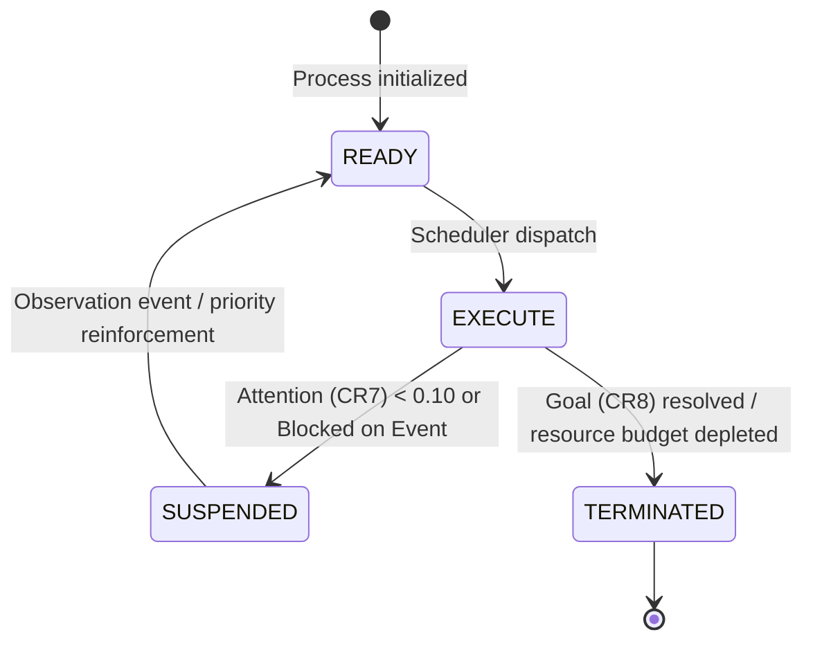

# CVM-KERN-0001: Scheduler Kernel

## 1. Objective
To specify how the Cognitive Kernel implements thread scheduling, context switching, and register budget distribution in runtime.

---

## 2. Process Thread States

The scheduler manages cognitive execution threads through five operational states:

---

## 3. Context Switching Semantics

When the scheduler switches execution from Thread $A$ to Thread $B$, it executes the following atomic operations:

1. **Halt execution**: Suspend CVM clock cycle and pause instruction fetch.
2. **Save Thread State**: Write active register values (`CR0` to `CR8`) and the current instruction pointer (`CIP`) of Thread $A$ to its Thread Control Block (TCB) in Working Memory.
3. **Load Thread State**: Overwrite CVM registers with the register values and `CIP` stored in Thread $B$'s TCB.
4. **Attention Allocation**: Write the recalculated attention budget $A_B$ to `CR7`.
5. **Resume execution**: Restart CVM instruction fetch.

---

## 4. Starvation Protection Heuristics

To prevent low-priority threads from being permanently starved by high-priority reasoning threads, the scheduler increments the idle clock count ($t_{\text{wait}}$) of all threads in the `READY` queue at every context switch. This dynamically increases their scheduling weight $W_{\text{sched}}$, guaranteeing that cleanup, memory compression, and background sensing threads eventually receive execution slices.
