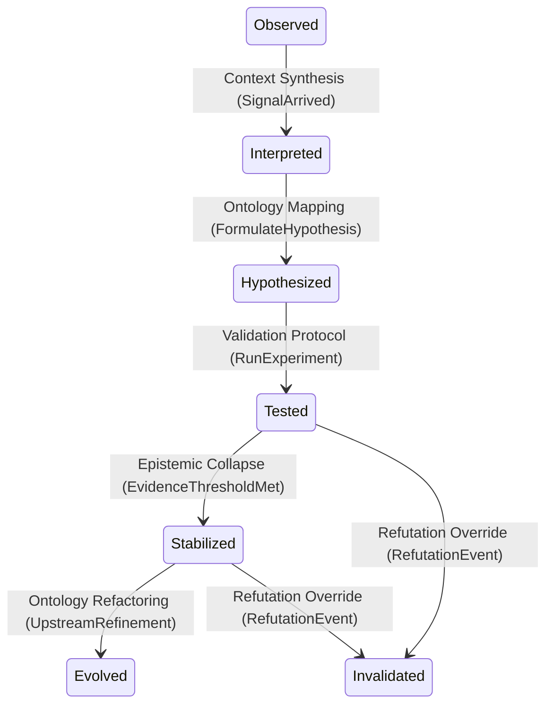

# CXM-0000: Cognitive Execution Model (CXM)

## 1. Objective
To specify the runtime behavior of the compiled Knowledge Graph, treating execution as a homeostatically regulated cognitive state machine that operates under strict resource constraints.

---

## 2. The Cognitive State Machine

Every compiled node in KIR is processed by the runtime as an active entity in a cognitive state machine. Transitions are triggered by events and constrained by resource parameters:

### Transition Specifications:
* **Perception Transition**: Transforms `Observed` signals to `Interpreted` beliefs. Consumes attention and memory resources.
* **Epistemic Collapse**: Compresses `Tested` beliefs into `Stabilized` knowledge when the evidence threshold is cleared.
* **Refutation Override**: Forces an immediate transition from any state to `Invalidated` when refuting evidence is recorded, dropping confidence to $0.00$.

---

## 3. Cognitive Resource Accounting

Cognitive operations are not free. The CXM implements resource accounting to prevent infinite reasoning loops, memory leaks, and context explosion. The runtime monitors seven resources:

1. **Attention**: The computational priority vector allocated to active nodes.
2. **Memory**: The active footprint of the reasoning graph in hot memory.
3. **Time**: The latency or step limit allocated to resolve constraints.
4. **Compute**: The inference or hardware floating-point operations budget.
5. **Energy**: The operational system budget (e.g., token limits or cost boundaries).
6. **Uncertainty**: The global entropy of active belief states.
7. **Trust**: The reliability weight of active observing nodes.

### Resource Cost Equation
Every transformation event $T$ incurs a resource cost:

$$\text{Cost}(T) = \text{Attention} \cdot \left( \mu \cdot \text{Compute} + \lambda \cdot \text{Memory} \right) + \text{Decay}(\text{Time})$$

If the system's global energy budget is depleted, the runtime enters a **Homeostatic Rest** cycle, suspending deep reasoning operations and triggering aggressive garbage collection to release active memory.
