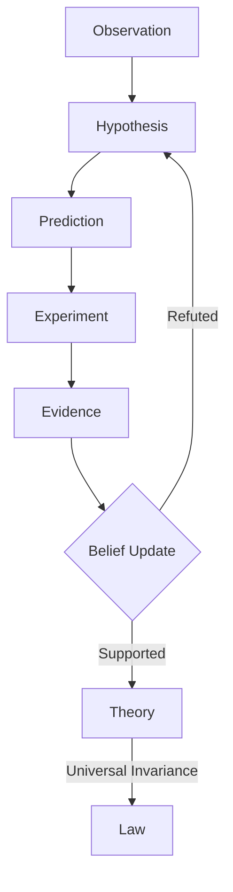

# FOUNDATIONS-0000: The Scientific Method in CSE

## 1. Objective
To define the formal cyclical process through which Cognitive Systems Engineering (CSE) observes, models, predicts, and validates cognitive phenomena within organizational ecosystems.

---

## 2. The Empirical Loop

CSE does not accept speculative constructs. Every architectural pattern or cognitive property must progress through a structured empirical loop:

1. **Observation**: A signal or pattern captured within the environment or cognitive simulator.
2. **Hypothesis**: A tentative explanation of the observed pattern, proposing a causal relationship or dynamic.
3. **Experiment**: A designed environment or protocol to test the hypothesis under controlled conditions.
4. **Evidence**: Structured empirical data generated by the experiment.
5. **Theory**: An explanatory framework supported by persistent evidence and verified predictions.
6. **Law**: A universally consistent relation that holds across all observed contexts.

---

## 3. The Four-Artifact Framework

No cognitive concept or architectural block may be advanced to the **Architecture** level without producing four mandatory elements:

1. **Definition**: The conceptual scope, properties, and teleology (defining *why* it exists and its evolutionary necessity).
2. **Model**: The behavioral, mathematical, or algebraic representation of its dynamics (how it behaves under interaction).
3. **Prediction**: A testable, falsifiable statement asserting what will occur under specific environmental or internal conditions if the model is correct.
4. **Experiment**: A concrete verification protocol defining the parameters, metrics, and methods to test the prediction.
