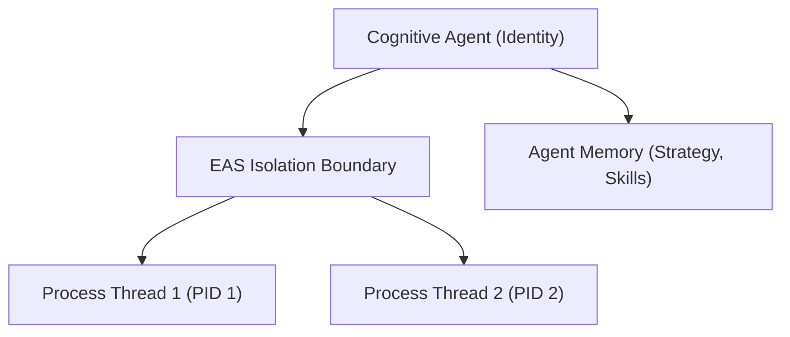
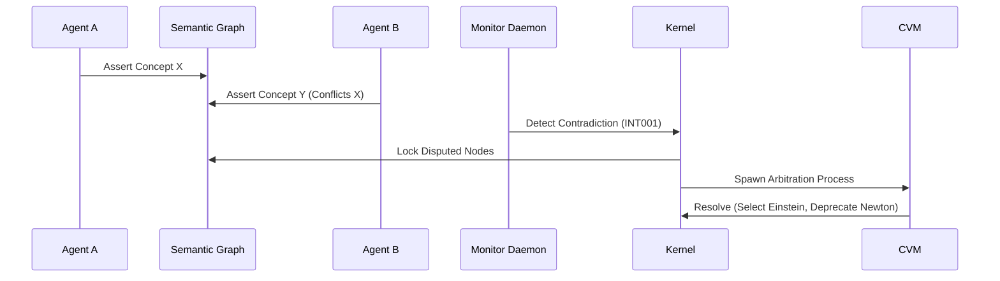

# CSERS SPRINT-4.0: Cognitive Agent Runtime (CAR) Design

## 1. Abstract Agent Model

A Cognitive Agent is a high-level entity owning a unique Epistemic Address Space (EAS) segment. Instead of mapping 1-to-1 with a single CVM process, it acts as an orchestrator that can spawn and manage multiple child process threads (PIDs) running concurrently.

---

## 2. In-Memory Graph Partitions

All memory (public and private) is hosted inside the unified **Graph Knowledge Engine**. Access isolation is enforced by the kernel using the agent's EAS boundaries:

* **Strategy Memory**: Stores the agent's current plans, heuristics, and procedural skills. Read-write access is restricted to the owning agent.
* **Experience Memory**: A temporal log of the agent's past observations, successes, and failed hypotheses.
* **Semantic & Genetic Memory**: Pointers to the shared global knowledge base.

---

## 3. Teleological Purpose Updates (CR8)

Agents are teleologically driven. While an agent's internal reflection loop may propose goal updates, modifying the `CR8` Purpose Vector requires calling the kernel syscall:

$$\text{SYS\_UPDATE\_PURPOSE(New\_Goal\_URI, Utility\_Function)}$$

The kernel resource manager checks the proposed goals against global invariants (Constitution laws) before committing the update.

---

## 4. Spawning Dynamics

An agent may dynamically spawn a new child agent if and only if:
1. The parent processes possess the `E-EVOLVE` system privilege key.
2. The parent delegates a slice of its current Resource Budget (`CR5`) to serve as the initial energy vector ($E_0$) for the child agent.

---

## 5. Multi-Agent Contradiction Arbitration

When concurrent agents assert contradicting concepts into the shared Semantic memory:

1. **Detection**: The Kernel's **Epistemic Monitor Daemon** detects the conflict.
2. **Interrupt**: Emits **INT001** (Contradiction Found) with severity level 2 (Recoverable).
3. **Lock & Spawn**: The kernel locks the disputed nodes, saving active contexts, and spawns a system-level **Arbitration Process** thread.
4. **Arbitration**: The process computes the Epistemic Arbitration Score ($S_{\text{arb}}$) to select the prevailing hypothesis and deprecate the loser in Genetic Memory.
